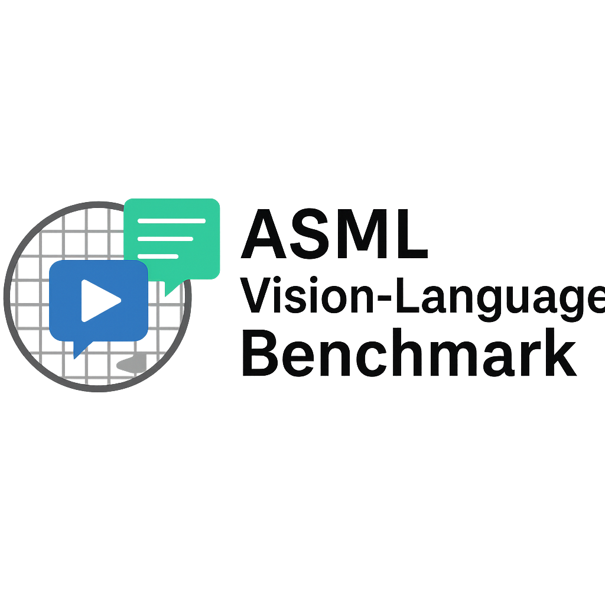

<p align="center">
  
</p>

# ASML Vision-Language Benchmark with Probabilistic Scoring

## Overview

This project investigates how a general-purpose Vision-Language Model (**OpenAI CLIP ViT-B/32**) behaves when applied to **semiconductor diagnostic tasks**, inspired by scenarios encountered at **ASML**.

Real-world EUV lithography diagnostics depend not only on identifying wafer defects — but on **knowing when the model is uncertain**.  
This repository benchmarks CLIP on synthetic wafer-defect imagery and evaluates **calibration, entropy, reliability, and confidence** to identify gaps between model predictions and trustworthy engineering-grade performance.

---

## Project Goals

### **1. Evaluate CLIP on ASML-style diagnostic imagery**
- Synthetic wafer defects: *scratch*, *particle contamination*, *none*
- Zero-shot classification using natural language prompts  
- Measure accuracy & distribution of predictions

### **2. Quantify Uncertainty**
- Probability entropy  
- Max-prob (confidence)  
- Brier score  
- Expected Calibration Error (ECE)

### **3. Generate Reliability & Calibration Reports**
These measures reveal **how much the model overestimates itself**, a critical issue in semiconductor safety-critical environments.

---

## Key Results

| Metric | Value |
|--------|--------|
| **Accuracy** | **34%** |
| **Expected Calibration Error (ECE)** | **0.52** |
| **Avg Confidence** | ~0.82 |
| **Avg Entropy** | ~0.55 |

### Interpretation

- CLIP is **highly overconfident** on semiconductor-style imagery  
- ECE > 0.5 indicates **severe miscalibration**  
- Accuracy remains low due to out-of-domain data  
- Highlights the need for **domain-specific VLMs or fine-tuning**

---

## Notebook: Uncertainty Analysis

The notebook `notebooks/uncertainty_analysis.ipynb` includes:

- Confidence histogram  
- Entropy histogram  
- Calibration curve  
- ECE computation  
- Scatter: confidence vs correctness  
- Summary metrics  

These plots reveal precisely where and why the model fails.

---

## Project Structure
=======
# Project Structure


```
asml-vlm-prob-benchmark/
│
├── data/
│   ├── images/                  # Synthetic wafer images
│   └── annotations/             # JSON annotations (task, label, prompt)
│
├── scripts/
│   ├── run_all.py               # FULL pipeline runner
│   ├── evaluate_clip.py         # Model evaluation and JSON export
│   ├── eval_calibration.py      # Calibration metrics
│   └── generate_reliability_plot.py
│
├── src/
│   ├── dataset.py               # WaferDataset loader
│   ├── model.py                 # CLIP wrapper (safetensors enforced)
│   └── metrics.py               # Confidence, entropy, Brier, calibration utils
│
├── reports/
│   ├── clip_results.json
│   ├── calibration_report.json
│   └── reliability_diagram.png
│
├── reports_archive/             # Auto-archived previous runs
└── README.md
```

---

# Results Summary

### Confidence Distribution
CLIP is consistently overconfident (~0.75–0.95), even when wrong.

### Accuracy
Overall accuracy in this domain: **~34%**  
— demonstrates *severe domain shift* from natural images to semiconductor imagery.

### Calibration Metrics
- **ECE:** ~0.55  
- **MCE:** ~0.82  

Large calibration errors indicate CLIP is **poorly aligned to its uncertainty**, making predictions appear more reliable than they truly are.

---

# Technical Highlights

### ✔ Modular architecture with reusable components  
### ✔ Zero-shot CLIP evaluation with strict safetensor enforcement (CVE-2025-32434 compliant)  
### ✔ Full uncertainty quantification pipeline  
### ✔ Auto-archiving of previous experimental runs  
### ✔ Reliability diagram + calibration analytics  
### ✔ Clean Python packaging with `src/` layout  
### ✔ Ready for extension with real ASML datasets or vision transformers  

---

# Why This Project Matters for ASML & Semiconductor AI

Semiconductor manufacturing demands:
- **High diagnostic precision**
- **Interpretability**
- **Fail-safe uncertainty awareness**

This benchmark demonstrates:
- How a generalist VLM behaves under **domain shift**
- Where confidence diverges from truth
- How models can be evaluated for **trustworthiness** before deployment  
- The foundation for building **ASML-specific VLM benchmarks** and multimodal datasets  

This kind of evaluation is essential to developing **safe, reliable AI tooling for EUV systems**.

---

# Installation

```
git clone https://github.com/QinnniQ/asml-vlm-prob-benchmark
cd asml-vlm-prob-benchmark
python -m venv .venv
.venv/Scripts/activate
pip install -r requirements.txt
```

---

# Run Full Pipeline

```
python scripts/run_all.py
```

Outputs are automatically stored in:

```
/reports
/reports_archive
```

---

# Roadmap

- Add ViT, SigLIP, and Qwen-VL baselines  
- Add larger defect taxonomy  
- Add ASML-style technical documents for multimodal grounding  
- Integrate modern calibration fixes (temperature scaling, Dirichlet)  
- Expand dataset realism with noise models & optical distortions  

---

## Acknowledgements

- OpenAI CLIP  
- HuggingFace Transformers  
- ASML for inspiring the diagnostic problem framing  

---

## Contact

If you’re interested in semiconductor AI, vision-language models, or uncertainty-aware ML:

**Nicholai Gay**  
AI Engineer  
📧 nicholai.gay@gmail.com 
🔗 LinkedIn: https://www.linkedin.com/in/nicholai-gay-201905148/
